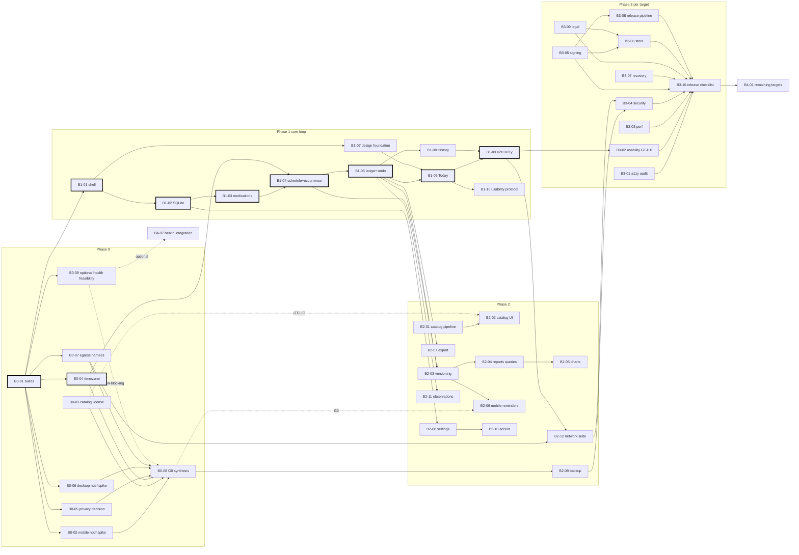

# MedTracker Backlog (Phases 0–4)

**Status:** Planning artifact. No ticket below is accepted as Done. A Phase 1 vertical slice (Tauri 2 + React/TypeScript/Vite + Rust, SQLite migrations, snapshots, ledger, History) already exists on `main` ([current-state.md](current-state.md)); it is a candidate starting point, not accepted work. Per governance rule 5 below, that code counts toward a ticket only after the ticket's tests and independent reviews pass, and four independent-review findings against it are being fixed first (see Phase 1 introduction).
**Governs with:** [product-spec.md](product-spec.md) (requirements `PR-xx`, phases, gates) · [registers.md](registers.md) (decisions `D-xx`, gates `GT-xx`) · [release-evidence.md](release-evidence.md).

The primary experience this backlog optimizes: a non-technical user opens **Today**, identifies the medication that is due, records **Taken** or **Skip**, and can **Undo** (PR-19–PR-21). Four primary targets: iOS, Android, Windows, macOS (PR-24). Excluded: accounts, auth, subscriptions, arbitrary sync, ads, analytics, dose recommendations, interaction checking, clinical claims (PR-22). Local SQLite is the source of truth and connectivity loss never blocks local logging (PR-01); the runtime network allowlist is currently empty (PR-23). Optional health-platform work is feasibility-only and non-blocking (PR-28, B0-09, B4-07).

## Governance rules

### Owner / model tiers (cost optimization)

| Tier | Who | Use for | Do not use for |
|---|---|---|---|
| **T1** | Haiku 5.5 subagent | Docs, formatting, fixtures, evidence-table filling, link/lint runs, mechanical refactors, validation scripts | Anything where a wrong answer is silent and costly (time math, crypto, security) |
| **T2** | Sonnet 5.5 subagent | Well-specified implementation and tests, UI components, repositories, adapters, independent code review | Open-ended architecture or threat modeling |
| **T3** | Sonnet 5.5 with high reasoning, used sparingly | DST/time-zone engine and its review, backup and crypto, security/privacy review, architecture, UX analysis of the core loop, phase-exit synthesis | Routine implementation, formatting, boilerplate |
| **H** | Human | Physical-device runs, accounts and enrollment, signing keys, store submission, legal/specialist review, stakeholder usability sessions | — |

**Model policy (D-18):** Haiku 5.5 (T1), Sonnet 5.5 (T2), and Sonnet 5.5 with high reasoning (T3). Default is T1/T2. T3 is required for DST/time-zone, backup, security, and architecture work and may be used elsewhere only where a ticket's **Owner** line says so.

### Review separation

1. **Author ≠ reviewer.** A reviewer is a fresh subagent invocation with no authoring context, given only the ticket, the diff, and the cited requirements.
2. Review gates: **RV-CODE** (T2 correctness/maintainability/tests), **RV-TIME** (T3 against §4 and the §10 fixture), **RV-SEC** (T3 privacy/security/allowlist), **RV-UX** (T3 core-loop heuristics vs [ux-journeys.md](ux-journeys.md)), **RV-A11Y** (T2 automated + checklist; human AT in Phase 3), **RV-DOC** (T1 consistency/link check), **RV-HUMAN** (H).
3. A ticket is **Done** only when its tests pass, every listed review gate has a recorded verdict by a different agent/person, and any evidence artifact is linked. Reviewers record verdicts in `docs/evidence/<ticket>/review-<gate>.md`.
4. Only a reviewer (never the author) may change a cell in [release-evidence.md](release-evidence.md) to **Passed**, and only with an artifact link. Authors may set **Blocked** with a reason.
5. **Pre-existing code is not evidence.** Code that already exists on another branch is audited against the owning ticket's acceptance criteria and review gates before it is adopted; passing builds on one host never count as evidence for another target.

### File-ownership rules

- Every path is owned by exactly one ticket at a time (see the map below). Others change it only through the owner's follow-up ticket or an append-only integration edit flagged in review.
- **Append-only integration points** (parallel tickets may add lines, never reorder or rewrite): `src-tauri/src/commands/mod.rs` registration list, `src-tauri/src/lib.rs` module list, `src-tauri/Cargo.toml` `[dependencies]`, `package.json` `dependencies`, `src/app/routes.ts`. Every new dependency is justified in the PR and checked against the §6 criteria and the empty network allowlist.
- Migrations are numbered files in `src-tauri/migrations/`; the owning ticket is named in the file header. Reserved: `0001` B1-02 (core schema per spec §5 except observation and notification bookkeeping); `0002` B2-11 (observation); `0003` B2-06 (notification bookkeeping). Later numbers are allocated in the ticket that needs them.
- Path names in the ownership map are the planned layout. The Phase 1 slice on `main` uses its own layout (for example `src-tauri/src/storage/sql/` for migrations); the B1-01/B1-02 audits either adopt that layout and update this map, or move the code. Until then the map is intent, not a description of the tree.
- Spike code lives only in `spikes/<ticket>/` and is never imported by product code. Evidence lives in `docs/evidence/<ticket>/`.

### Planned repository layout and owners

| Path | Owner ticket |
|---|---|
| `spikes/B0-*/**`, `docs/evidence/B0-*/**` | the matching B0 ticket |
| `docs/product-spec.md`, `docs/registers.md`, `docs/release-evidence.md` (structure) | B0-08 (product owner, T3) |
| `docs/ux-journeys.md` | B1-10 |
| `.markdownlint-cli2.jsonc` and doc-check config | B0-00 |
| `src-tauri/Cargo.toml`, `tauri.conf.json`, `capabilities/**`, `src/main.rs`, `src/lib.rs`, `src-tauri/src/commands/mod.rs`, `src/lib/ipc/**`, `src/app/**`, `vite.config.ts`, `.github/workflows/ci.yml` | B1-01 |
| `src-tauri/migrations/0001_*.sql`, `src-tauri/src/storage/{db,migrate,integrity}.rs` | B1-02 |
| `src-tauri/src/domain/medication/**`, `storage/medication_repo.rs`, `commands/medication.rs`, `src/features/medications/**` | B1-03 |
| `src-tauri/src/time/**`, `domain/schedule/**`, `storage/schedule_repo.rs`, `commands/schedule.rs`, `src/features/schedules/**` | B1-04 |
| `src-tauri/src/domain/event/**`, `storage/event_repo.rs`, `commands/event.rs` | B1-05 |
| `src-tauri/src/application/today.rs`, `commands/today.rs`, `src/features/today/**` | B1-06 |
| `src/ui/**` (tokens, components), `src/styles/**` | B1-07 |
| `src/features/history/**`, `commands/history.rs` | B1-08 |
| `tests/e2e/**`, `tests/a11y/**` | B1-09 |
| `tools/catalog-build/**`, `catalog/fixtures/**` (synthetic only) | B2-01 |
| `src-tauri/src/catalog/**`, `src/features/catalog/**`, `commands/catalog.rs` | B2-02 |
| `src-tauri/src/time/versioning/**`, `domain/schedule/version/**`, `application/reconcile.rs` | B2-03 |
| `src-tauri/src/application/reports.rs`, `commands/reports.rs` | B2-04 |
| `src/features/reports/**` | B2-05 |
| `src-tauri/src/notifications/**`, `src/features/settings/notifications/**`, migration `0003` | B2-06 |
| `src-tauri/src/export/**`, `src/features/export/**` | B2-07 |
| `src/features/settings/**` (except `notifications/`), `src-tauri/src/application/wipe.rs` | B2-08 |
| `src-tauri/src/backup/**`, `src/features/backup/**` | B2-09 |
| `src/styles/accent/**` | B2-10 |
| migration `0002`, `domain/observation/**`, `src/features/observations/**` | B2-11 |
| `tests/network/**` | B2-12 |
| `tools/egress-check/**` | B0-07 |
| `.github/workflows/release-*.yml`, `docs/release-checklist.md` | B3-08 / B3-10 |

### CI cost policy (D-08, reversible)

Target-neutral logic tests and doc checks run on the cheapest runner on each change; this does not make Linux a target or a gate. Per-target builds for iOS, Android, Windows, macOS are on-demand or pre-release and path-filtered; target evidence always comes from a real build of that target. Release/signing workflows are introduced only in B3-08, after the relevant gates have artifacts.

## Dependency graph (critical path in bold)

## Ticket template fields

Each ticket lists: **Phase · Priority (Must/Should/Could) · Effort (S/M/L/XL) · Requirements** · **Owner** · **Depends on** · **Files owned** · **Acceptance** (Given/When/Then or checkable) · **Tests** · **Review gates**. "Evidence" means an artifact under `docs/evidence/<ticket>/`; no ticket may claim a gate passed without it.

---

## Phase 0 — feasibility and risk reduction

### B0-00 — Doc-check tooling
**Phase 0 · Should · S · PR-18** · **Owner:** T1 · **Depends on:** none · **Files:** `.markdownlint-cli2.jsonc`, doc-check notes in `docs/evidence/B0-00/`
- **Acceptance:** a documented command lints all `*.md` and checks relative links; it runs offline for internal links; known-noisy rules are configured, not silenced wholesale.
- **Tests:** run the command on the current docs; zero errors, or each remaining error listed with a reason.
- **Review:** RV-DOC.

### B0-01 — Four-target build and install baseline
**Phase 0 · Must · L · PR-16, PR-17, PR-24** · **Owner:** T2 builds; **H** supplies hosts/devices/accounts · **Depends on:** none
**Files:** `spikes/B0-01/**`, `docs/evidence/B0-01/**`
- **Acceptance:** for each of iOS, Android, Windows, macOS: a minimal Tauri v2 app builds from a clean checkout and installs/launches on a real device or host, **or** a "blocked: <missing host/device/account/toolchain>" record names the human action needed. Records: toolchain versions, app-data path, signing/provisioning prerequisites, build time. No product UI. Simulator/emulator runs are recorded as such and never marked as physical-device evidence.
- **Tests:** scripted build log per target; launch screenshot or log; uninstall/reinstall note.
- **Review:** RV-CODE (scripts), RV-HUMAN (device claims).
- **Note:** on the planning host, Xcode and the Rust iOS targets are installed, but no Android SDK/Java runtime was found and Windows needs another host (see [current-state.md](current-state.md)). Windows and Android therefore start as "blocked: missing host/toolchain" until a human provides them.

### B0-02 — iOS/Android native notification spike
**Phase 0 · Must · XL · PR-13, PR-05** · **Owner:** T2 implements; **H** runs devices; T3 reviews results · **Depends on:** B0-01
**Files:** `spikes/B0-02/**`, `docs/evidence/B0-02/**`
- **Acceptance:** executes spec §8 on physical iOS and Android devices: one-shot, daily wall-clock, cancel/reschedule after schedule-version change, occurrence-ID payload that opens the app without writing a dose; scenarios for locked/foreground/background/terminated, reboot, permission denied/re-enabled, battery saver/Doze, time-zone change while closed, DST gap/fold, clock jump, edit with old request pending; Android exact-alarm and notification permission cases. Pass/fail per §8 thresholds; a go/no-go per platform. Un-run scenarios are listed as **not run**, not assumed.
- **Tests:** evidence table with device/OS/build/permission/scheduled UTC+local/observed time/duplicates/stale requests.
- **Review:** RV-SEC (payload privacy), RV-HUMAN (device evidence). **Gate:** GT-DEV-IOS, GT-DEV-AND stay NOT PASSED until this artifact exists and a reviewer accepts it.

### B0-03 — Catalog license and field-selection decision
**Phase 0 · Must · L · PR-02, PR-18, PR-25** · **Owner:** T2 research draft; **H** legal/source-owner decision · **Depends on:** none
**Files:** `docs/evidence/B0-03/**`
- **Acceptance:** release-specific written decision per the GT-LIC checklist (spec §6): exact source/release/checksum, field and term-type whitelist, derived-output redistribution position, attribution/currentness text, update policy; RxTerms availability confirmed or excluded; **or** an explicit "blocked" decision keeping manual entry only. The agent draft is input to the human decision and is not itself approval.
- **Tests:** checklist completeness review; no real catalog rows committed.
- **Review:** RV-HUMAN (**GT-LIC**), RV-DOC.

### B0-04 — Time engine and native zone probe
**Phase 0 · Must · L · PR-03, PR-04, PR-07** · **Owner:** T3 designs and reviews; T2 implements · **Depends on:** B0-01 (zone probe per target); Rust-only tests need nothing
**Files:** `spikes/B0-04/**`, `docs/evidence/B0-04/**`
- **Acceptance:** deterministic tests reproduce every §4 worked example (travel modes, New York 2026-03-08 gap, 2026-11-01 fold, date-line); tzdb version captured; native current-zone lookup on each target returns a valid IANA ID or a recorded "unsupported" result; recommendation for whether `device_local` mode is promised per target.
- **Known finding to carry in (D-04a):** the Phase 0 spike found that `chrono-tz` 0.10.4 bundles tzdb 2025b, stale against IANA 2026f. The ticket evaluates `jiff` 1.x with bundled tzdb as the engine, records the reported tzdb version, and re-checks currency at pin time. This is a library finding, not a device result.
- **Tests:** table-driven Rust tests (fixed vectors in the evidence file); native probe log per target.
- **Review:** RV-TIME.

### B0-05 — Privacy, backup, and encryption decision
**Phase 0 · Must · M · PR-10, PR-11, PR-12, PR-18** · **Owner:** T3 · **Depends on:** B0-01
**Files:** `docs/evidence/B0-05/**`
- **Acceptance:** decision matrix per target for: app-data location, automatic cloud/OS backup behavior and exclusion options (each marked verified-by-test or **unverified**), key storage options, SQLCipher need/cost, user backup format outline, deletion limits; ratifies or replaces D-15 (OS protection baseline).
- **Tests:** per-target backup-behavior test where devices exist; otherwise "unverified" with reason.
- **Review:** RV-SEC.

### B0-06 — Windows/macOS notification spike
**Phase 0 · Should · L · PR-13** · **Owner:** T2 implements; **H** runs hosts · **Depends on:** B0-01
**Files:** `spikes/B0-06/**`, `docs/evidence/B0-06/**`
- **Acceptance:** records behavior of immediate notifications via the official plugin on installed Windows and macOS builds, and feasibility of one native scheduling integration each (app closed, sleep, restart); verdict per platform: add reminders later / in-app only. No claim without a run.
- **Tests:** evidence table as B0-02.
- **Review:** RV-HUMAN, RV-SEC.

### B0-07 — Egress harness and CSP baseline
**Phase 0 · Must · M · PR-17, PR-22, PR-23** · **Owner:** T2 · **Depends on:** B0-01
**Files:** `tools/egress-check/**`, `docs/evidence/B0-07/**`
- **Acceptance:** a documented, repeatable procedure (per target where feasible) that blocks/captures network egress while a built app runs and reports DNS/HTTP attempts; the baseline spike app shows zero attempts; the CSP/capability configuration that yields an empty allowlist is documented, including how Tauri's internal IPC/asset origins appear (verified, not assumed).
- **Tests:** harness negative control (a deliberate request is detected).
- **Review:** RV-SEC.

### B0-08 — Phase 0 evidence synthesis (G0)
**Phase 0 · Must · M · PR-16, PR-24** · **Owner:** T3 (product owner role) · **Depends on:** B0-02, B0-03, B0-04, B0-05, B0-06, B0-07
**Files:** `docs/product-spec.md` (decisions/matrix updates), `docs/registers.md`, `docs/release-evidence.md` (status updates), `docs/evidence/B0-08/**`
- **Acceptance:** per platform: reminder scope (full / best-effort / in-app only), build status, blockers; registers updated; each decision marked with its evidence link; items still lacking evidence remain NOT PASSED.
- **Tests:** RV-DOC consistency pass across all docs.
- **Review:** RV-HUMAN (product-owner acceptance) → **G0**.

### B0-09 — Optional health-platform feasibility (non-blocking)
**Phase 0 · Could · M · PR-28, PR-01, PR-05** · **Owner:** T3 research; **H** authorizes and runs devices · **Depends on:** B0-01 · **Requires separate user authorization before any work starts**
**Files:** `docs/evidence/B0-09/**`, `spikes/B0-09/**` (if a prototype is authorized)
- **Acceptance:** a written go/no-go per platform for HealthKit (iOS) and Android Health Connect / Google health: supported data types, whether medication records can be read or written at all, permissions and consent, OS/version requirements, whether the integration is on-device or needs the network (and so needs a PR-23 allowlist entry), whether Tauri needs a native bridge, duplicate/provenance handling, and revocation. Un-run device checks are marked **not run**. Platform acceptance of a record is documented as not proving a dose was taken.
- **Tests:** none required for a document-only outcome; any prototype is throwaway under `spikes/B0-09/`.
- **Review:** RV-SEC, RV-HUMAN. **Does not block G0, Phase 1, Phase 2, or any release.**

---

## Phase 1 — the Today core loop

Phase 1 tickets need their listed dependencies only; none waits on the catalog, notification spike, mockups, or G0. The Phase 1 slice already on `main` (Rust `application/ledger.rs`, `application/medication.rs`, SQLite migrations, React Today/History/Medications views, Vitest and Rust tests) is a **candidate starting point** for B1-01…B1-08. Its own handoff records 8/8 UI tests and 10/10 Rust tests passing, which is not acceptance. The audit must check it against these tickets (notably: a schedule/occurrence engine with IANA zones, the `voided` undo semantics, immutable versions, and the explicit occurrence link are required here; device-local zone handling and notifications are stubs).

Four independent-review findings against the slice are being fixed and are folded into the tickets below as acceptance items, not separate scope:

| Finding (severity) | Owning ticket |
|---|---|
| Backdated/corrected wall times use the current-day offset instead of the offset for the entered date, giving wrong instants across DST (high) | B1-04, B1-05 (RV-TIME) |
| Today is not refreshed at midnight, on resume/focus, or when an item becomes due; stale slot-linked dates are not rejected in Rust (medium) | B1-06 |
| Upgrades lack a pre-migration snapshot and `integrity_check`, and there is no recoverable UI state for migration/newer-database failures (medium) | B1-02 |
| Undo is soft/reversible but per-event privacy deletion is missing (redact notes and revision payloads, record a tombstone) (medium) | B1-05 |

### B1-01 — Tauri shell, typed command boundary, empty-allowlist CSP
**Phase 1 · Must · M · PR-01, PR-15, PR-17, PR-22, PR-23** · **Owner:** T2 · **Depends on:** B0-01 (soft: B0-07 CSP findings)
**Files:** see ownership map (shell/config/ipc/`ci.yml`)
- **Acceptance:** React+TypeScript+Vite app launches with the network blocked on each target with a build baseline; a typed command round-trip works; no raw-SQL or generic-execute command; CSP and capabilities grant no remote origin; no HTTP/updater/analytics dependency; `ci.yml` runs target-neutral tests and doc checks.
- **Tests:** command round-trip test; dependency scan asserts no network-capable plugin; CSP assertion test.
- **Review:** RV-CODE, RV-SEC.

### B1-02 — SQLite schema, repository foundation, migrations
**Phase 1 · Must · L · PR-11, PR-12** · **Owner:** T2 · **Depends on:** B1-01 (interim D-15 baseline)
- **Acceptance:** per-app `user-data.sqlite` created in the platform data dir; migration `0001` implements spec §5 tables for medication, schedule, occurrence, event (incl. `status active/voided/deleted`), revision (incl. `kind`), preferences; `foreign_keys=ON` per connection; `user_version` migrations in a transaction; pre-migration snapshot via backup API/`VACUUM INTO`; integrity and foreign-key checks; failed migration keeps the original; migration failure and newer-database cases reach a recoverable UI state (not a blank crash).
- **Tests:** invalid FK/CHECK rejected; rollback; migration failure injection; reopen preserves rows; no-downgrade refusal.
- **Review:** RV-CODE.

### B1-03 — Medication snapshots and manual entry
**Phase 1 · Must · M · PR-02** · **Owner:** T2 · **Depends on:** B1-02
- **Acceptance:** create/edit/archive a manual medication; each edit makes a new immutable `medication_version`; historical display fields preserved; product strength shown separately from amount-per-event help text; no dose calculation; catalog fields nullable and unused.
- **Tests:** version immutability; archive keeps history; manual add works with the network blocked.
- **Review:** RV-CODE, RV-UX (add-medication path).

### B1-04 — Schedule v1 and occurrence engine (wall-clock)
**Phase 1 · Must · XL · PR-03 (create/end), PR-07, PR-08 (partial)** · **Owner:** T3 design + RV-TIME; T2 implements · **Depends on:** B1-03, B0-04
- **Acceptance:** create a schedule for a medication with one or more daily/weekday wall-clock slots in `device_local` or `home_zone`, previewing the next seven occurrences with zone abbreviation/offset; immutable `schedule_version`; occurrences materialized per version with local date/time, zone, offset, fold, UTC instant, tzdb version; wall times (including backdated and corrected entries) are resolved with the IANA rules for the entered date, never the current-day offset; DST gap → one occurrence at first valid instant marked adjusted; fold → one occurrence at earlier offset; at most one occurrence per slot per local date; end schedule creates a closing version without backfill. Edit/pause/resume and elapsed-interval mode are **out of scope** (B2-03).
- **Tests:** the §4 and §10 fixtures (including `2026-03-08T07:30:00Z`); date-line; occurrence uniqueness; end-schedule no backfill.
- **Review:** RV-TIME, RV-CODE.

### B1-05 — Event ledger: take/skip, linking, undo, corrections
**Phase 1 · Must · L · PR-04, PR-05, PR-06, PR-08, PR-20, PR-21** · **Owner:** T2; T3 for RV-TIME · **Depends on:** B1-03, B1-04
- **Acceptance:** record take/skip events with separate `occurred_at_utc` and `entered_at_utc`, original local/zone/offset, optional amount (mantissa+scale)/note; explicit link to an occurrence on card action; **undo = `status voided` + `void` revision retaining values**; Taken↔Skip change is one transaction with no moment of two active events; restore-from-void; correction creates a revision; privacy delete is a separate per-event action that redacts notes and revision payloads and records a tombstone; conflicting active take+skip surfaced as conflict; as-needed events without occurrence.
- **Tests:** PR-04/05/06/20/21 Given/When/Then from the spec; transaction atomicity; backdated event `2026-01-15T08:00:00-05:00` → `2026-01-15T13:00:00Z`; delete leaves no values in revision.
- **Review:** RV-CODE, RV-TIME.

### B1-06 — Today screen (core loop UI)
**Phase 1 · Must · L · PR-19, PR-20, PR-21, PR-15** · **Owner:** T2; T3 for RV-UX · **Depends on:** B1-04, B1-05, B1-07
**Files:** `application/today.rs`, `commands/today.rs`, `src/features/today/**`
- **Acceptance:** Today is the launch screen; derives Due now / Upcoming / Recorded / Earlier-not-logged from stored occurrences and events (spec invariants 8–10); card shows medication name, strength, scheduled local time and zone context where it differs from device zone; **Taken** and **Skip** are single taps with large touch targets; Undo is persistent after an action and always reachable; Log as needed for as-needed medications; Today refreshes at local midnight, on resume/focus, and when an occurrence becomes due, and Rust rejects stale slot-linked dates; empty, loading, and error states per [ux-journeys.md](ux-journeys.md); permission/reminder status line that never claims delivery; no word "missed"/"overdue"; state conveyed by text and icon, not color alone.
- **Tests:** component tests per state; the PR-19/20/21 Given/When/Then as automated tests against a real in-memory/temp DB; keyboard-only completion of the loop; screen-reader label assertions.
- **Review:** RV-UX, RV-A11Y, RV-CODE.

### B1-07 — Design foundation (tokens and accessible components)
**Phase 1 · Must · M · PR-15, PR-17, PR-26 (readiness)** · **Owner:** T2 · **Depends on:** B1-01
- **Acceptance:** bundled design tokens (spacing, type scale, color roles incl. a replaceable accent role and fixed destructive/success/warning roles, focus ring) inspired by Geist principles; components: Button, Card, Sheet/Dialog, Tabs/Nav (bottom bar narrow, side rail wide), Snackbar-with-Undo, Banner, Empty/Loading/Error states; light/dark; reduced-motion; no remote fonts or assets; any adopted Geist asset's license is verified first (D-14).
- **Tests:** contrast checks for all role pairs against WCAG 2.2 AA; focus-visible tests; responsive snapshot at phone/tablet/desktop widths.
- **Review:** RV-A11Y, RV-CODE.

### B1-08 — History timeline
**Phase 1 · Must · M · PR-05, PR-09, PR-15, PR-21** · **Owner:** T2 · **Depends on:** B1-05, B1-07
- **Acceptance:** chronological ledger with take/skip/voided/corrected markers and not-logged distinct from skipped; original / current-device / selected-zone time views without mutating stored values; per-event Undo/restore/correct; filters by medication and type.
- **Tests:** zone-switch test asserting UTC/original context unchanged; undo from History matches PR-21; keyboard and screen-reader pass.
- **Review:** RV-A11Y, RV-CODE.

### B1-09 — Core-loop end-to-end and accessibility harness
**Phase 1 · Must · M · PR-01, PR-15, PR-19–PR-21, PR-23** · **Owner:** T2 · **Depends on:** B1-06, B1-08
**Files:** `tests/e2e/**`, `tests/a11y/**`
- **Acceptance:** scripted journeys run on each target shell that has a build baseline: add medication → schedule → Today → Taken → Undo; Skip → Undo; Taken→Skip change; restart persistence; DB-row assertions; automated accessibility checks; uses the B0-07 egress harness to confirm zero connections. Targets without a baseline are listed as blocked.
- **Tests:** the suite itself, plus a deliberate-failure canary.
- **Review:** RV-CODE. **Exit:** with B1-01…B1-08 completes **G1**.

### B1-10 — Usability protocol and UX heuristic review
**Phase 1 · Must · M · PR-27, PR-15** · **Owner:** T3 · **Depends on:** B1-06
**Files:** `docs/ux-journeys.md` (updates), `docs/evidence/B1-10/**`
- **Acceptance:** a moderated-test protocol for the core loop (participant profile "non-technical user", tasks, observation sheet, proposed success threshold for product-owner approval, consent/data handling with no recording of real medication data); independent heuristic review of the built Today flow with findings turned into backlog tickets. **No participant data is fabricated; GT-UX remains NOT PASSED until B3-02.**
- **Tests:** protocol dry-run with a surrogate script (not counted as evidence).
- **Review:** RV-HUMAN (protocol approval).

---

## Phase 2 — complete MVP

### B2-01 — Catalog pipeline on synthetic fixtures
**Phase 2 · Must · L · PR-01, PR-02, PR-17, PR-25** · **Owner:** T2 · **Depends on:** B1-01
- **Acceptance:** deterministic builder from a fixture in the RRF shape to a read-only `catalog.sqlite` with manifest, FTS5 index, row-count/duplicate-ID/label checks and release-diff tooling; **fixtures are synthetic**; the builder refuses to run against real data unless a GT-LIC approval file is present.
- **Tests:** deterministic-output hash; FTS matches; refusal test; retired/merged ID diff test.
- **Review:** RV-CODE, RV-SEC.

### B2-02 — Catalog bundle and search UI (GT-LIC-gated)
**Phase 2 · Should · M · PR-02, PR-25** · **Owner:** T2 · **Depends on:** B2-01, B1-03, **GT-LIC passed**
- **Acceptance:** search by name/ingredient/strength/form with no network; selection creates a snapshot; "no longer current" note for retired entries; attribution/currentness text in About; without GT-LIC the feature is flag-off and absent from distributed builds.
- **Tests:** search latency measured on the real file; snapshot unchanged after catalog swap; build-flag test.
- **Review:** RV-CODE, RV-HUMAN (licensing artifacts).

### B2-03 — Schedule versioning, elapsed interval, reconciliation
**Phase 2 · Must · XL · PR-03, PR-07, PR-08** · **Owner:** T3 design + RV-TIME; T2 implements · **Depends on:** B1-04, B1-05, B0-04
- **Acceptance:** edit/pause/resume/end as immutable versions with explicit effective instants; `elapsed_interval` mode (`anchor + n × interval`); supersession of future occurrences without touching past ones; zone-change and tzdb-change reconciliation on launch/resume; non-overlapping version ranges validated in a transaction; UI for edit with preview.
- **Tests:** §4 fixtures for all three modes; no backfill across pause; supersession keeps originals; tzdb-change scenario.
- **Review:** RV-TIME, RV-CODE, RV-UX.

### B2-04 — Outcome linkage and report queries
**Phase 2 · Must · L · PR-05, PR-08, PR-09** · **Owner:** T2 · **Depends on:** B1-05, B2-03
- **Acceptance:** §10 fixture yields 4 total / 2 logged / 1 skipped / 1 not logged / 0 conflict; multiple linked takes count once; voided events excluded; conflict surfaced; zone/day-boundary choices (stored schedule-local date default); elapsed-interval and as-needed queries.
- **Tests:** fixture; zone grouping change test; voided exclusion.
- **Review:** RV-TIME, RV-CODE.

### B2-05 — Reports UI and charts
**Phase 2 · Should · M · PR-08, PR-09, PR-15** · **Owner:** T2 · **Depends on:** B2-04, B1-08, B1-07
- **Acceptance:** outcome bars, event timeline, elapsed intervals, as-needed activity; metric definition, range, zone, denominator visible; equivalent table for every chart; no adherence score or causal language; Chart.js bundled locally or SVG fallback (D-13).
- **Tests:** chart-data equals fixture; table parity; bundle contains no remote URL.
- **Review:** RV-UX, RV-A11Y.

### B2-06 — Mobile reminder adapter and reconciliation (G0-gated)
**Phase 2 · Should · L · PR-13, PR-05, PR-07** · **Owner:** T2; T3 for RV-SEC · **Depends on:** B0-08 (G0 verdict for that platform), B2-03, B1-06
- **Acceptance:** `ReminderScheduler` port with adapters only for platforms whose spike verdict allows it; bounded rolling queue; cancel/replace on schedule or zone change; generic payload by default; request/accepted/delivered/opened states stored separately; tap opens the occurrence and writes **no** event; denial leaves everything else working; Today shows permission state truthfully.
- **Tests:** "tap does not log" test; stale-request cancellation test; permission denied/revoked UI test; device re-run of the B0-02 matrix on the adapter (H).
- **Review:** RV-SEC, RV-CODE, RV-HUMAN.

### B2-07 — CSV/JSON export
**Phase 2 · Must · M · PR-10, PR-09** · **Owner:** T2 · **Depends on:** B1-05, B2-11
- **Acceptance:** user-chosen destination via OS picker; manifest (time, zone, schema, definitions); occurrence/event/version IDs and original timestamps; voided events only when history is explicitly included; plain-export warning; temp files cleaned.
- **Tests:** round-trip schema test; warning shown; temp cleanup.
- **Review:** RV-SEC, RV-CODE.

### B2-08 — Settings and privacy surfaces
**Phase 2 · Must · M · PR-11, PR-13, PR-18, PR-22** · **Owner:** T2 · **Depends on:** B1-02, B1-07
- **Acceptance:** display-zone default, notification permission status and OS-settings link, privacy/preview setting, data deletion and full wipe with limits text, catalog/version info, About/disclaimer (no clinical claim, no compliance claim); wipe cancels reminders through a port (no-op until B2-06); **no account, sign-in, subscription, or sync controls exist.**
- **Tests:** wipe removes DB, sidecars, temp; copy-text review; repository scan for excluded features.
- **Review:** RV-SEC, RV-UX.

### B2-09 — Encrypted backup and restore
**Phase 2 · Must · XL · PR-10, PR-12** · **Owner:** T3 design/review; T2 implements · **Depends on:** B1-02, B1-05, B0-08
- **Acceptance:** consistent snapshot; versioned format with a vetted AEAD and password KDF (no custom crypto); restore validates in a staging file (authentication, version, integrity, FK), takes a pre-restore snapshot, swaps atomically; clear errors for wrong passphrase, corruption, newer format; local file only, no network.
- **Tests:** the spec §10 backup/restore matrix incl. truncation, malformed manifest, disk-full atomicity, older-version migration.
- **Review:** RV-SEC (T3), RV-CODE.

### B2-10 — Accent color presets (Could)
**Phase 2 · Could · S · PR-26** · **Owner:** T2 · **Depends on:** B1-07, B2-08
- **Acceptance:** bundled presets (e.g., blue, green, purple, orange, red as a starting list) applied only to the accent role; destructive remains distinct; contrast verified for every preset in light/dark; selection persists.
- **Tests:** contrast matrix; destructive-distinct test; persistence.
- **Review:** RV-A11Y. **Cut first** if Phase 2 slips.

### B2-11 — Notes and observations
**Phase 2 · Should · M · PR-04, PR-06** · **Owner:** T2 · **Depends on:** B1-02, B1-05
- **Acceptance:** user-defined label/value/text attached to a medication, event, or timestamp with the same time-context capture and revision/delete rules; displayed as user reports; no interpretation.
- **Tests:** migration `0002` up-tests; revision/delete tests.
- **Review:** RV-CODE.

### B2-12 — Network-isolation suite
**Phase 2 · Must · M · PR-01, PR-22, PR-23** · **Owner:** T2 · **Depends on:** B0-07, B1-09, B2-09
**Files:** `tests/network/**`
- **Acceptance:** full journey set including export, backup, restore under an egress blocker yields zero attempts per target that has a build; static check that CSP/capabilities/dependencies contain no remote origin or network plugin; fails if the empty allowlist changes without a register entry.
- **Tests:** negative control; allowlist-diff test.
- **Review:** RV-SEC.

---

## Phase 3 — native integrations, hardening, and first release (per target)

Each Phase 3 ticket is executed per target (iOS, Android, Windows, macOS) and recorded in that target's matrix in [release-evidence.md](release-evidence.md). All Phase 3 gates are **NOT PASSED — evidence-dependent** until artifacts exist.

### B3-01 — Accessibility audit with assistive technology
**Phase 3 · Must · L · PR-15** · **Owner:** H + T2 · **Depends on:** B2-05, B2-08 · **Gate:** GT-A11Y
- **Acceptance:** WCAG 2.2 AA checklist run per target with VoiceOver (iOS/macOS), TalkBack, a Windows screen reader, keyboard-only (desktop), text scaling, contrast, focus order, reduce-motion; defects ticketed; conformance stated only per target with evidence.
- **Review:** RV-A11Y, RV-HUMAN.

### B3-02 — Stakeholder usability study (GT-UX)
**Phase 3 · Must · L · PR-27** · **Owner:** H facilitates; T1 compiles · **Depends on:** B1-10, B2-08
- **Acceptance:** sessions per the approved protocol with representative non-technical participants on at least one target per form factor (phone, desktop) available at the time; results reported against the pre-approved threshold; failures become tickets; no data invented.
- **Review:** RV-HUMAN (product owner). **Gate:** GT-UX.

### B3-03 — Performance and size baselines
**Phase 3 · Should · M · PR-16** · **Owner:** T2 · **Depends on:** B2-09
- **Acceptance:** per-target install size, cold launch, Today render, timeline/chart query on the fixture, backup/restore time, memory — measured on named devices, recorded with method; regression budgets proposed from measurements; no promises beyond the data.
- **Review:** RV-CODE.

### B3-04 — Security and privacy review
**Phase 3 · Must · M · PR-01, PR-18, PR-22, PR-23** · **Owner:** T3 + H specialist · **Depends on:** B2-06, B2-09, B2-12
- **Acceptance:** threat-model check per spec §9; log redaction, temp-file, notification preview, backup-exclusion, wipe, allowlist, and dependency review; findings dispositioned.
- **Review:** RV-HUMAN.

### B3-05 — Signing and notarization proof (GT-SIGN)
**Phase 3 · Must · L · PR-24** · **Owner:** **H** accounts/keys; T2 scripts · **Depends on:** B2-09
- **Acceptance:** per target, a signed installable artifact produced and installed on a clean device/host, with the mechanism, cost, renewal cadence, key custody, and operational owner documented; keys never in the repo. Mechanisms (Apple signing/notarization, Play App Signing, Windows code signing) are candidates verified against current vendor docs during this ticket.
- **Review:** RV-HUMAN. **Gate:** GT-SIGN.

### B3-06 — Store readiness (GT-STORE)
**Phase 3 · Must · L · PR-24** · **Owner:** **H** · **Depends on:** B3-05, B3-09
- **Acceptance:** per target distribution channel chosen and a submission-ready (or beta-channel-tested) package with privacy disclosures matching actual behavior (no data collected, no network); review outcomes recorded.
- **Gate:** GT-STORE.

### B3-07 — Recovery, upgrade, and deletion tests
**Phase 3 · Must · M · PR-10–PR-12** · **Owner:** T2 · **Depends on:** B2-08, B2-09
- **Acceptance:** per target: upgrade from a prior DB preserving records; failed-migration recovery; restore from backup; full wipe results and stated limits; low-storage behavior.
- **Review:** RV-SEC. **Gate:** GT-REC.

### B3-08 — Release pipeline
**Phase 3 · Should · M · PR-24** · **Owner:** T2 · **Depends on:** B3-05, B2-12
**Files:** `.github/workflows/release-*.yml`
- **Acceptance:** per-target workflows triggered manually or on release tags only; pinned dependencies; secrets via CI secret store; SBOM; no always-on multi-platform builds; cost estimate documented.
- **Review:** RV-SEC, RV-CODE.

### B3-09 — Legal, intended-use, and disclosure review (GT-LEGAL)
**Phase 3 · Must · M · PR-18, PR-25** · **Owner:** **H** specialist · **Depends on:** B2-08 (and B2-02 if catalog ships)
- **Acceptance:** written review of intended-use wording, no-clinical-claim posture, privacy notice, store disclosures, and catalog attribution; actions ticketed.
- **Gate:** GT-LEGAL.

### B3-10 — Release checklist and evidence compilation
**Phase 3 · Must · S · PR-24** · **Owner:** T1 compiles; T3 product-owner sign-off · **Depends on:** B3-01 … B3-09
**Files:** `docs/release-checklist.md`
- **Acceptance:** per-target checklist: functional completion, docs, performance, security review, backup test, recovery test, matrix fully linked; any NOT PASSED cell blocks that target's release.
- **Review:** RV-DOC, RV-HUMAN → **G3** (per target).

---

## Phase 4 — cross-platform parity and improvements

### B4-01 — Close remaining target gaps
**Phase 4 · Must · L · PR-24** · **Owner:** T2 + H · **Depends on:** B3-10 for the first released target; per-target Phase 3 tickets for the rest
- **Acceptance:** each primary target not yet at G3 reaches G3, or has a product-owner-accepted recorded reason; no platform is shipped without its matrix complete.

### B4-02 — Desktop reminders (conditional)
**Phase 4 · Could · L · PR-13** · **Owner:** T2; T3 RV-SEC · **Depends on:** B0-06 verdict, B3-10
- **Acceptance:** only if B0-06 + a follow-up spike pass for the platform; otherwise closed as won't-do with the in-app limitation disclosed.

### B4-03 — Additional schedule patterns (research-gated)
**Phase 4 · Could · M · PR-03** · **Owner:** T2/T3 · **Depends on:** B3-02 results
- **Acceptance:** added only for patterns users demonstrably need; no arbitrary RRULE editor.

### B4-04 — Localization
**Phase 4 · Could · M · PR-15** · **Owner:** T1/T2 · **Depends on:** B3-10
- **Acceptance:** locale/date/number/unit display beyond the initial locale; strings externalized; layout stress-tested.

### B4-05 — Optional updater decision
**Phase 4 · Could · S · PR-23** · **Owner:** T3 · **Depends on:** B3-10
- **Acceptance:** decision record; adopting an updater adds an allowlist entry and requires the PR-23 process, or the decision is "stores/installers only".

### B4-07 — Optional health integration (conditional)
**Phase 4 · Could · XL · PR-28, PR-01, PR-05, PR-23** · **Owner:** T2; T3 for RV-SEC · **Depends on:** B0-09 go verdict, separate user authorization, B3-10
- **Acceptance:** built only if B0-09 returned go for that platform and the product owner authorizes it; explicit per-platform authorization and revocation; imported records carry source/provenance and require user-reviewed duplicate decisions before becoming ledger events; export is explicit; platform acceptance is never labeled a verified dose; failure, denial, or revocation leaves Today, logging, and history fully usable; any network endpoint passes the PR-23 allowlist process first. Otherwise closed as won't-do.
- **Tests:** duplicate-candidate, revoked-authorization, adapter-failure-leaves-ledger-unchanged, and "no adapter writes a take event" tests.
- **Review:** RV-SEC, RV-CODE, RV-HUMAN.

### B4-06 — Linux evaluation (only if requested)
**Phase 4 · Could · M · —** · **Owner:** T2 · **Depends on:** explicit product request
- **Acceptance:** non-primary; gates nothing; adds no CI cost to primary targets.

---

## Requirement traceability

| Requirement | Tickets |
|---|---|
| PR-01 | B1-01, B1-09, B2-01, B2-12, B3-04, B0-09, B4-07 |
| PR-02 | B1-03, B2-01, B2-02, B0-03 |
| PR-03 | B1-04, B2-03, B4-03 |
| PR-04 | B1-05, B2-11, B0-04 |
| PR-05 | B1-05, B1-08, B2-04, B2-06 |
| PR-06 | B1-05, B2-08, B2-11 |
| PR-07 | B1-04, B2-03, B2-06 |
| PR-08 | B1-04, B1-05, B2-03, B2-04, B2-05 |
| PR-09 | B1-08, B2-04, B2-05, B2-07 |
| PR-10 | B2-07, B2-09, B3-07 |
| PR-11 | B1-02, B2-08, B0-05 |
| PR-12 | B1-02, B2-09, B3-07 |
| PR-13 | B0-02, B0-06, B2-06, B2-08, B4-02 |
| PR-14 | B1-01 (architecture review), B1-02 |
| PR-15 | B1-01, B1-06, B1-07, B1-08, B1-09, B2-05, B3-01, B4-04 |
| PR-16 | B0-01, B0-08, B3-03 |
| PR-17 | B0-01, B0-07, B1-01, B1-07, B2-01 |
| PR-18 | B0-03, B2-08, B3-04, B3-09 |
| PR-19 | B1-06, B1-09 |
| PR-20 | B1-05, B1-06, B1-09 |
| PR-21 | B1-05, B1-06, B1-08, B1-09 |
| PR-22 | B0-07, B1-01, B2-08, B2-12, B3-04 |
| PR-23 | B0-07, B1-01, B2-12, B4-05, B4-07 |
| PR-24 | B0-01, B0-08, B3-05, B3-06, B3-08, B3-10, B4-01 |
| PR-25 | B0-03, B2-01, B2-02, B3-09 |
| PR-26 | B1-07, B2-10 |
| PR-27 | B1-10, B3-02 |
| PR-28 | B0-09, B4-07 |

Every PR-01–PR-28 appears at least once. Governance, cost, and review-separation rules are in this document and are not product requirements.
