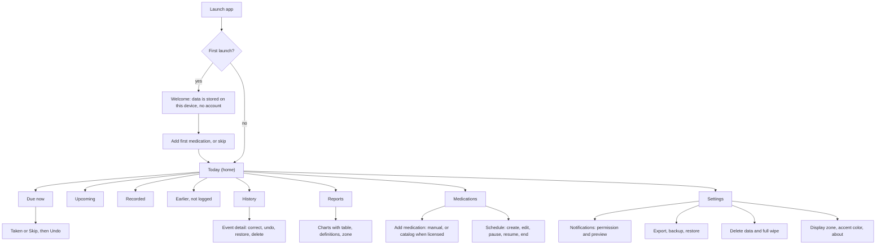
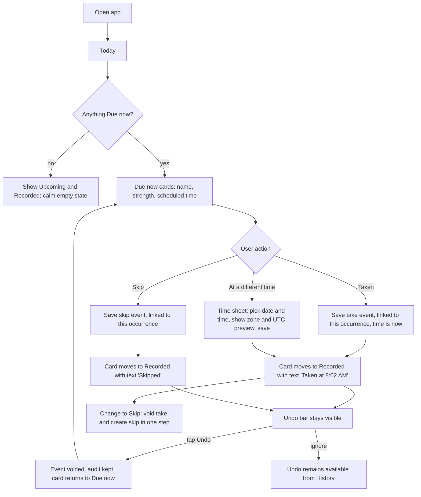
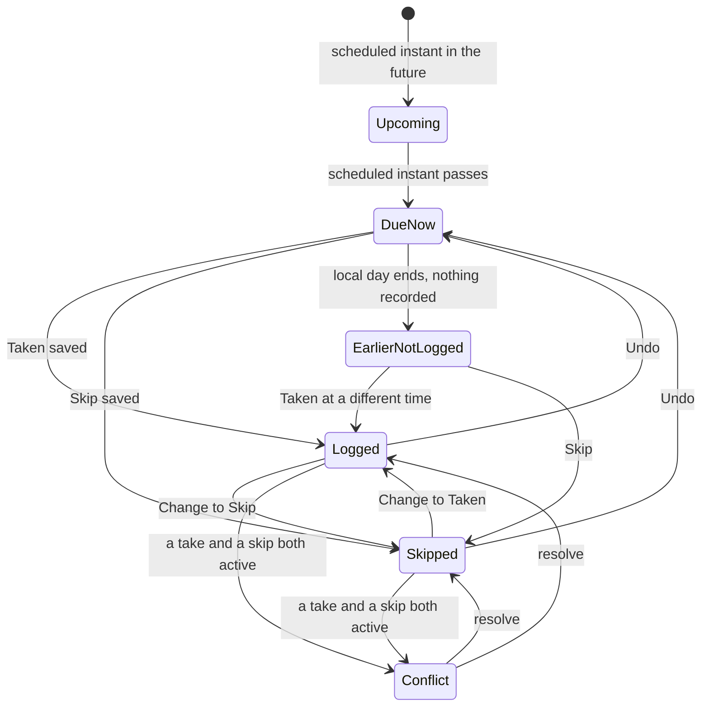
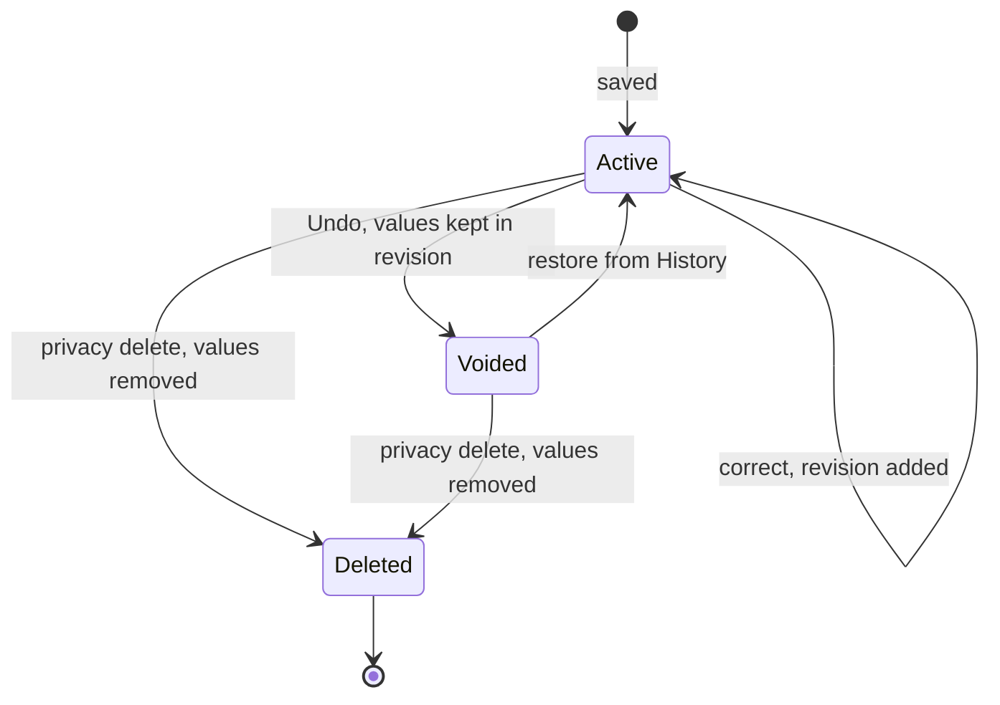
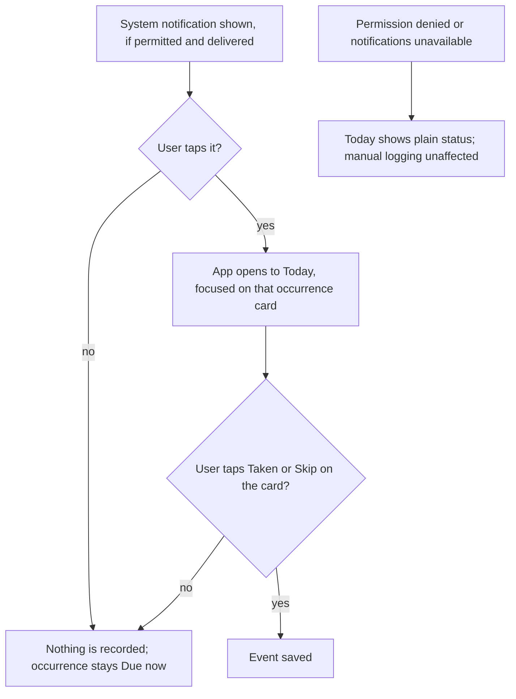
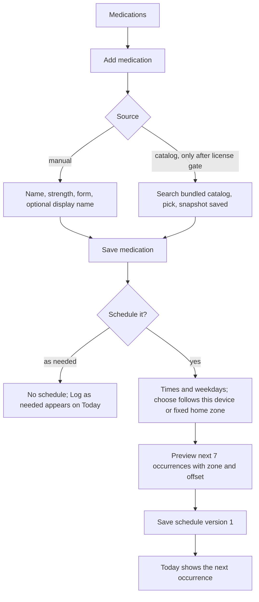
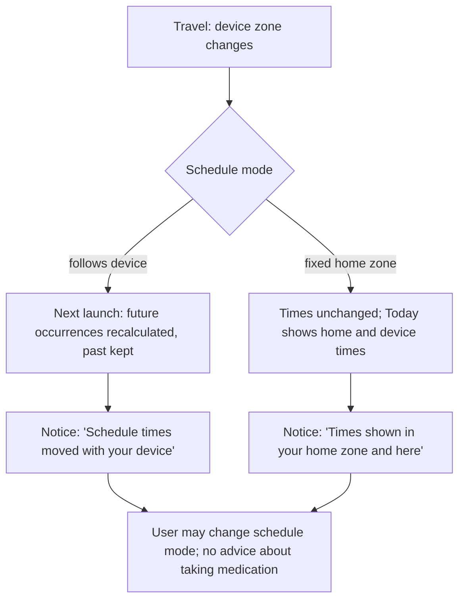
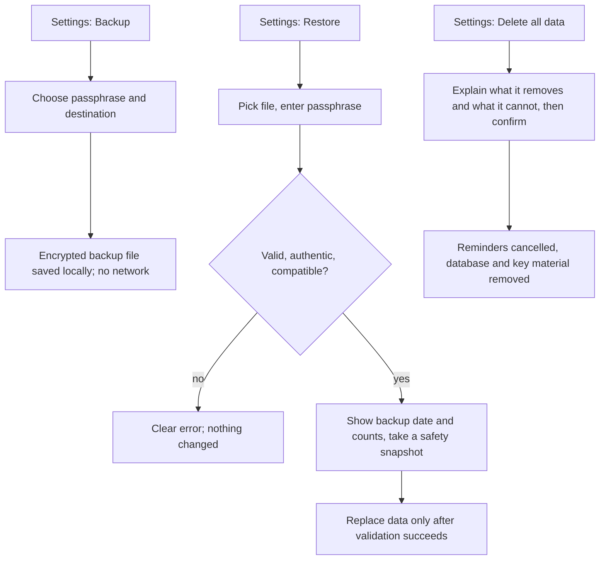

# MedTracker UX Journeys and Flows

**Status:** Reviewable draft for design review. Design review is **parallel to and does not block** Phase 1 engineering (D-07). Requirements: [product-spec.md](product-spec.md) (PR-15, PR-19–PR-21, PR-27). Tickets: B1-06, B1-07, B1-08, B1-10.

**Primary experience:** a non-technical user opens **Today**, identifies the medication that is due, records **Taken** or **Skip**, and can **Undo** an accidental action.

No sign-in, registration, subscription, or sync appears anywhere in these flows (PR-22). The app is local-first: every flow below works with no connectivity, and the runtime network allowlist is currently empty (PR-23). Optional health-platform integration (PR-28) is feasibility-only and has no screen here until it is authorized; if it is ever added, its failure must never hide or block the flows in this document.

## 1. Personas (scoped)

| Persona | Status | Goals | Pain points | Primary workflow | Accessibility needs |
|---|---|---|---|---|---|
| **Patient (primary)** — a non-technical person managing their own medications | **In scope** | Know what is due; record it with one tap; trust that history is right; fix a mistake | Dense forms; unclear labels; unsure whether something was already recorded; fear of tapping the wrong thing | Open Today → Taken/Skip → (Undo) | Large text and touch targets, high contrast, screen reader, simple vocabulary, no color-only state, tolerance for tremor/low dexterity |
| **Traveling patient** — same person across time zones | In scope (same persona) | Schedules and history that stay understandable after travel | Confusing times after a zone change | Check Today; see schedule zone vs device zone | As above |
| **Caregiver helper** — sets up the app on the patient's device | Deferred (DF-01); no shared records or accounts | Set up medications and schedules quickly | Same-device handoff, fear of breaking history | One-time setup using Medications/Schedule screens | As above |
| **Family member** | Deferred (DF-01) | Review history | Cannot access without the device | — | — |
| **Healthcare provider** | Out of scope (DF-02) | — | — | Receives a user-initiated export only | — |
| **Administrator** | Not applicable (EX-10): no accounts to administer | — | — | — | — |

The persona set is derived from the product brief, not from user research. Whether real users match it is tested by GT-UX (B3-02, **NOT PASSED — evidence-dependent**).

## 2. App flow (no authentication)



## 3. Core loop: Today → identify due → Taken/Skip → Undo



Step-by-step (what the user sees):

| # | User goal | Screen state | System behavior | Failure handling |
|---|---|---|---|---|
| 1 | Open the app | Today is the launch screen | Loads occurrences for the current local day from the local DB | Load error: plain message + "Try again"; no data is invented |
| 2 | Find what is due | **Due now** at the top, one card per occurrence: medication name, strength, scheduled local time | Due is derived: scheduled instant has passed and no active take/skip is linked | None due: "Nothing due right now" and the next Upcoming time |
| 3 | Record Taken | Large **Taken** button on the card | One tap saves a take event with `occurred_at` = now, linked to the occurrence | Save error: card stays in Due now, message "Not saved. Try again."; never shows Recorded unless the write succeeded |
| 4 | Record Skip | **Skip** button of equal size next to Taken | Saves a skip event linked to the occurrence | Same as step 3 |
| 5 | Confirm what happened | Card moves to **Recorded** with text ("Taken at 8:02 AM" / "Skipped") and an icon; a transient bar says what was recorded | State is shown by text and icon, never by color alone | — |
| 6 | Undo a mistake | **Undo** is on the confirmation bar and on the Recorded card | Event becomes `voided`; occurrence returns to Due now; audit revision kept | If the bar is dismissed, Undo remains on the card and in History |
| 7 | Change Taken↔Skip | "Change to Skip/Taken" on the Recorded card | One transaction: void the old, create the new; never two active events | Failure rolls back; old event stays |

Design rules for the loop:

- Taken and Skip are single taps. No confirmation dialog on the primary buttons: reversibility comes from Undo, not from "Are you sure?". (Destructive actions such as permanent delete do use a confirmation.)
- No word "missed" or "overdue" anywhere; an unlogged earlier occurrence is "Earlier, not logged".
- A reminder or notification never records anything; opening one lands on the relevant card.
- The Undo affordance does not auto-dismiss in a way a screen-reader or low-dexterity user cannot reach; the Recorded card keeps its own Undo.
- Touch targets for Taken/Skip/Undo: recommend at least 44 px (product recommendation; WCAG 2.2 AA's minimum is smaller).

## 4. State models





## 5. Notification interaction (never records a dose)



## 6. Setup flows





## 7. Data safety flows



## 8. Screen specifications

Each screen lists purpose, user goals, actions, entry/exit points, and error/empty/loading states (per the product-owner brief).

| Screen | Purpose and goals | Actions | Entry → exit | Empty | Loading | Error |
|---|---|---|---|---|---|---|
| **Today** | See what is due; record; undo | Taken, Skip, At a different time, Undo, Change, Log as needed, open card detail | Launch/notification tap/nav → any tab | First run: "Add your first medication" button. Nothing scheduled: "No medications scheduled today" + Log as needed if any. Nothing due: "Nothing due right now", next time shown | Skeleton cards; actions disabled until loaded | "Couldn't load today. Try again." Save failure keeps card in place with message. Loss of connectivity never produces an error here: Today does not use the network |
| **Onboarding** | Explain local-first storage, no account; get to first medication | Continue, Skip | First launch → Today | n/a | n/a | n/a |
| **Medications list** | Manage medications | Add, open, archive | Nav → detail/add | "No medications yet" + Add | Skeleton | Retry |
| **Medication add/edit** | Create a snapshot | Save, cancel | Medications → Schedule or Medications | n/a | Catalog search spinner (when licensed) | Field-level validation text |
| **Schedule editor** | Define when doses are expected | Times, weekdays, zone mode, preview, save, end (edit/pause/resume in Phase 2) | Medication → Medications | Prompt to set a schedule | Preview calculation | "That time doesn't exist on that date" notices show the adjusted time instead of blocking |
| **Time sheet** ("at a different time") | Backdate Taken/Skip | Pick date/time/zone, save | Card → Today | n/a | n/a | Invalid time message |
| **History** | Review ledger; undo/restore/correct | Filter, switch time view, open event | Nav → event detail | "Nothing recorded yet" | Skeleton rows | Retry |
| **Event detail** | See and fix one event | Correct, Undo, Restore, Delete (confirm) | History → History | n/a | n/a | Save error keeps old values |
| **Reports** | Descriptive charts and definitions | Range, zone, medication filter, view table | Nav → — | "Not enough recorded data for this range" | Chart skeleton | Retry; table always available |
| **Settings** | Preferences and data safety | Notifications, display zone, accent, export, backup, restore, delete, about | Nav → sub-screens | n/a | n/a | Per-action errors |
| **Notification settings** | Truthful permission state | Request permission, open OS settings, preview toggle | Settings/Today status line → — | n/a | n/a | "Notifications are off. You can still record doses." |

## 9. Layout and wireframes

Phone (portrait), low fidelity:

```text
┌──────────────────────────────┐
│ Today · Tue, Mar 10          │
│ [reminders: on / off status] │
├──────────────────────────────┤
│ DUE NOW                      │
│ ┌──────────────────────────┐ │
│ │ Medication A  5 mg tablet│ │
│ │ 8:00 AM                  │ │
│ │ [   Taken   ] [  Skip  ] │ │
│ └──────────────────────────┘ │
│ UPCOMING                     │
│ ┌──────────────────────────┐ │
│ │ Medication B  · 8:00 PM  │ │
│ └──────────────────────────┘ │
│ RECORDED                     │
│ ✓ Medication C Taken 7:55 AM │
│               [ Undo ]       │
├──────────────────────────────┤
│ Today  History  Reports  Meds│
└──────────────────────────────┘
```

Desktop (Windows/macOS window), low fidelity: a compact side rail with Today / History / Reports / Medications and Settings; Today content in a centered column with the same cards; Taken/Skip/Undo are keyboard-reachable buttons in logical tab order with visible focus; tablet widths use the same single column up to a comfortable reading width, then a two-column Due now / Recorded layout.

High-fidelity mockups and the component library are produced alongside B1-07 and reviewed in parallel; they do not gate engineering. Visual language: Geist-inspired principles (readability, whitespace, focus-driven layouts, low visual noise, fast feedback) implemented with locally bundled fonts and assets, never fetched at runtime (PR-17, D-14). Accent color (PR-26) changes only the accent role; destructive actions stay visually distinct; state is never color alone.

## 10. Writing rules

- Plain words: "Taken", "Skip", "Undo", "Due now", "Upcoming", "Recorded", "Earlier, not logged".
- Never: "missed", "overdue", "non-adherent", "should", "recommended dose", "safe", or any clinical judgment.
- Recorded state text includes the time and, when the schedule zone differs from the device zone, the zone.
- Errors say what happened and what still works ("Not saved. Your other records are safe.").

## 11. Accessibility acceptance (WCAG 2.2 AA target; evidence per target in B3-01)

- Whole core loop operable by keyboard alone (desktop) and by screen reader (VoiceOver, TalkBack, a Windows screen reader).
- Visible focus; logical focus order; focus moves to the updated card after an action and to the Undo control when it appears.
- Dynamic type/text scaling and zoom without loss of Taken/Skip/Undo.
- Contrast for every color-role pair, including each accent preset, light and dark.
- Live-region announcements for "Taken recorded" and "Undone".
- Reduced-motion respected; no time-limited interactions.
- Every chart has an equivalent table.

## 12. Review checklist for RV-UX (B1-10)

1. From cold launch, how many taps to record Taken for a due medication? (Target: one tap from Today.)
2. Can a user tell, without color, what is recorded, skipped, due, or not logged?
3. After a wrong tap, is Undo reachable within the same view without navigation?
4. Does any text imply clinical judgment or "missed" doses?
5. Does anything on Today or in Settings suggest an account, subscription, or sync?
6. Is the notification/permission state truthful and non-blocking?
7. After a time-zone change, are schedule and device times distinguishable?
8. Are empty, loading, and error states present and plain?
9. Does any screen imply that logging needs an internet connection, or that an external health platform confirmed a dose?

Findings become backlog tickets; GT-UX (real users, pre-approved threshold) is separate and remains **NOT PASSED — evidence-dependent**.
